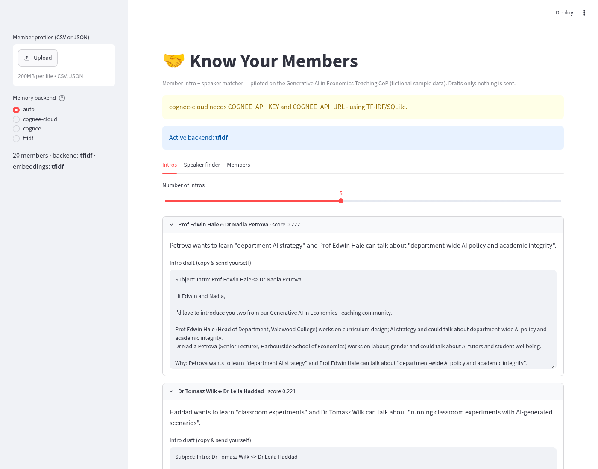
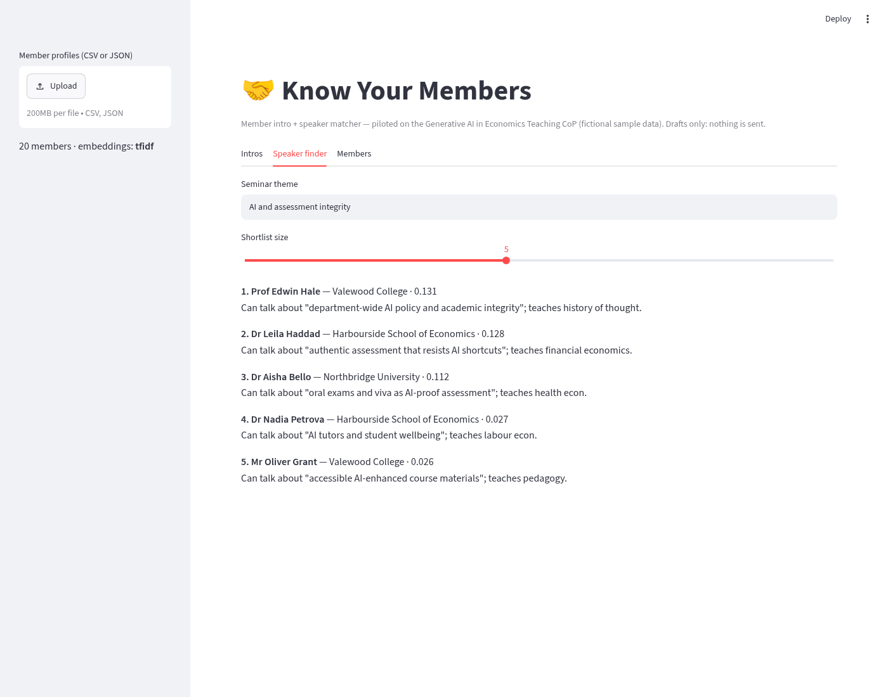

# Know Your Members 🤝

Open-source **member intro and speaker matcher** for communities of practice. Piloted on the *Generative AI in Economics Teaching Community of Practice* (LSE). Built for the Grok Bot Community Engineering London Hackathon, Track 2 "Know Your Members".

> All sample members in `data/` are **fictional**. Intro emails are **drafts only**. Nothing is ever sent automatically.

## Problem
Communities grow faster than organisers can learn who's who. The person who wants to learn about AI-proof assessment rarely meets the person who has already redesigned theirs. Finding seminar speakers relies on whoever the organiser happens to remember.

## What it does
- **Ingest** member profiles from CSV or JSON (`name, role, institution, interests, teaching_topics, can_talk_about, wants_to_learn`).
- **Embed and store**: OpenAI-compatible embeddings if a key is set, otherwise **TF-IDF** so it always runs offline. Vectors are stored in local SQLite (`kym.sqlite`), with an optional Supabase pgvector mirror.
- **Intros**: ranks cross-institution pairs by profile similarity plus complementarity ("A wants to learn what B can talk about"). Each pair gets a one-line reason and a ready-to-edit intro draft. The LLM writes these if a key is set, otherwise a template does. Each member is capped at 2 intros.
- **Speaker finder**: give it a seminar theme and get a ranked shortlist with reasons.
- **Streamlit UI** and a **CLI**.




## Run it next week for your community (5 minutes)
1. Export a member survey (Google Form or MS Form) to CSV with the columns above. The column names must match exactly.
2. Set up and run:
```bash
git clone https://github.com/meleantonio/know-your-members && cd know-your-members
python3 -m venv .venv && source .venv/bin/activate
pip install -r requirements.txt
streamlit run app.py        # then upload your CSV in the sidebar
```
3. Or use the CLI:
```bash
python -m kym.cli --members your.csv intros -k 8 --drafts
python -m kym.cli --members your.csv speakers "AI and assessment integrity"
python -m kym.cli intros --json > intros.json
```
4. Optional: `cp .env.example .env`, fill in the keys, then `pip install openai supabase` and `set -a; source .env`.

### Optional Supabase pgvector table
```sql
create extension if not exists vector;
create table members (name text primary key, data jsonb, embedding vector(1536));
```
(TF-IDF vectors vary in dimension, so only enable the Supabase mirror together with API embeddings.)

## Optional: Cognee memory backend 🧠
[Cognee](https://github.com/topoteretes/cognee) (a hackathon technology partner) can serve as the member memory. When enabled, profiles are ingested with `cognee.add` and `cognee.cognify`, which builds a knowledge graph. After that, `cognee.search` (GRAPH_COMPLETION) ranks the speaker shortlist and adds graph context to each intro reason.
```bash
pip install -r requirements-cognee.txt      # pinned cognee==1.6.5 (heavy, so it's optional)
export LLM_API_KEY=...                       # required by Cognee
# OpenAI-compatible endpoint: also set LLM_PROVIDER / LLM_MODEL / LLM_ENDPOINT (see Cognee docs)
KYM_BACKEND=cognee streamlit run app.py      # or use the "Memory backend" toggle in the sidebar
python -m kym.cli --backend cognee speakers "AI and assessment integrity"
```
### Hosted Cognee (MCP connector inside Grok Bot)
For the hackathon demo, the profiles were also stored in **hosted Cognee** through its MCP connector (`remember` / `recall`, dataset `know-your-members-demo`). The box has no hosted-API key or URL, so the repo has **no `cognee-cloud` code mode yet**. The hosted demo runs through the connector, and the local `cognee` mode above is the code path. You can see the real recall outputs and timings, plus a comparison with TF-IDF, in [docs/cognee-mcp-demo.md](docs/cognee-mcp-demo.md).

**It never breaks the demo.** If Cognee isn't installed, `LLM_API_KEY` is missing, or ingest or search fails, the app shows a notice and falls back to TF-IDF/SQLite. Code: `kym/cognee_backend.py`.

## Privacy
Get members' consent before you ingest their profiles. Keep real CSVs and `kym.sqlite` out of git (`.gitignore` covers `*.sqlite` and `.env`).

## License
MIT
